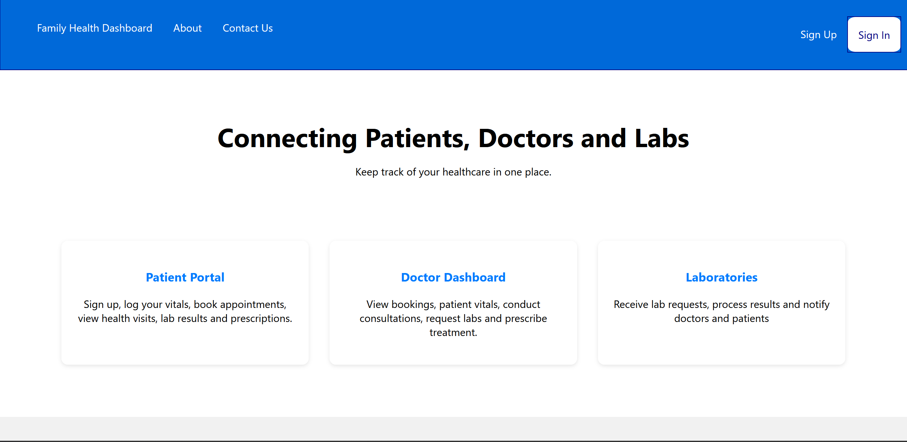
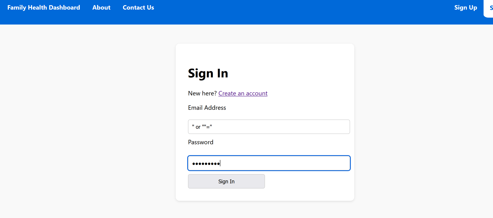
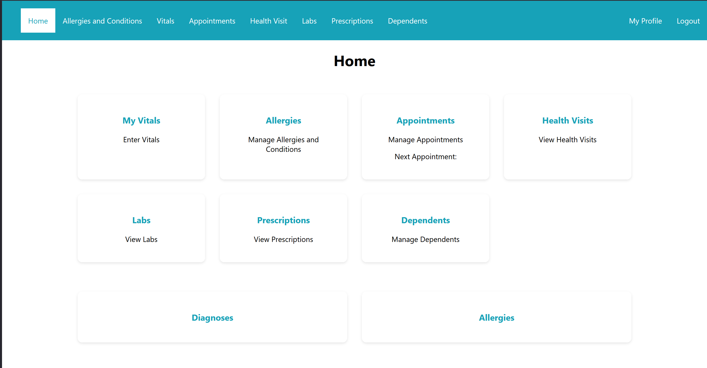
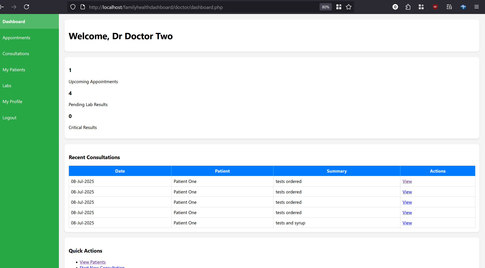
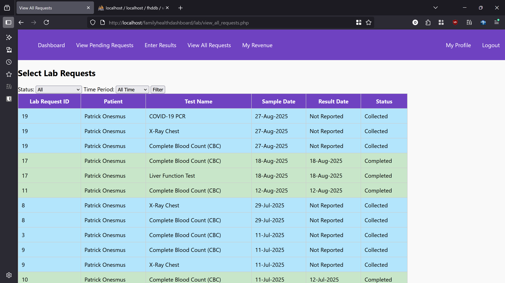
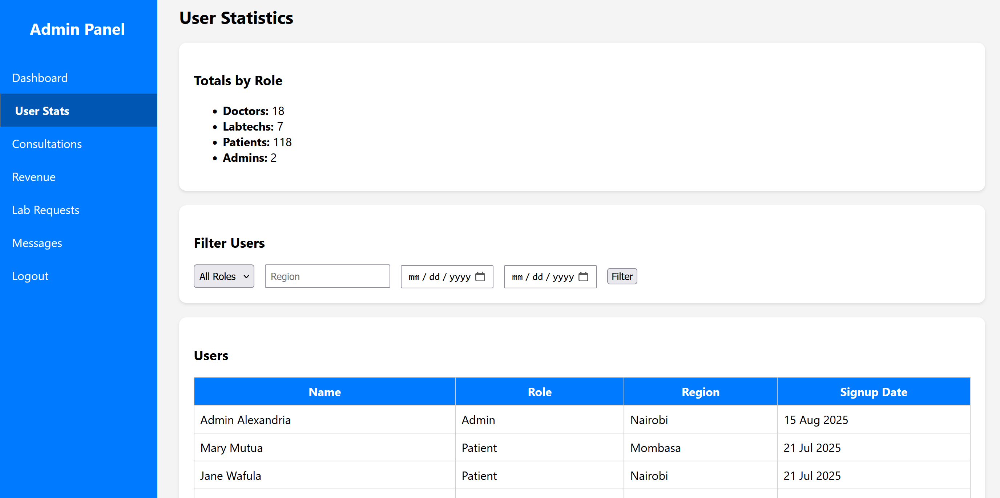

# Family Health Dashboard System

## Overview
The Family Health Dashboard System is a web-based application designed to help families manage and track medical information in a centralized, role-based, and secure environment. The system supports multiple user roles including patients, doctors, and lab technicians.

## Problem Statement
Health records are often fragmented across different facilities and paper-based systems. This project aims to centralize medical information while maintaining privacy, access control, and usability for different stakeholders.

## Key Features
- Role-based access control (Patient, Doctor, Lab Technician)
- Appointment scheduling and visit tracking
- Lab test requests and result entry
- Prescription management
- Patient vitals and medical history tracking
- Authentication and session management

## Tech Stack
- **Backend:** PHP
- **Database:** MySQL
- **Frontend:** HTML, CSS, JavaScript
- **Environment:** Linux
- **Tools:** Git, VS Code

## Security Considerations
- Role-based access control (RBAC) to restrict sensitive data
- Input validation to reduce SQL injection and XSS risks
- Session-based authentication
- Principle of least privilege applied across user roles

## What I Learned
- Designing relational databases for real-world healthcare data
- Implementing authentication and authorization logic
- Thinking about security early in application design
- Managing multi-role workflows in a single system
- Debugging and maintaining a growing codebase

## Future Improvements
- Password hashing and stronger authentication mechanisms
- Audit logging for user actions
- Encryption of sensitive data
- API-based architecture
- Two-factor authentication (2FA)

## Screenshots

### Landing Page

### Login Page

### Patient Dashboard

### Doctor Dashboard

### Lab Results

## Admin Dashboard

## Database Schema

## Security & Privacy Note
This repository contains a sanitized and partial representation of the system.
Sensitive configuration details, credentials, and patient data handling logic
have been intentionally excluded to protect privacy and security.
